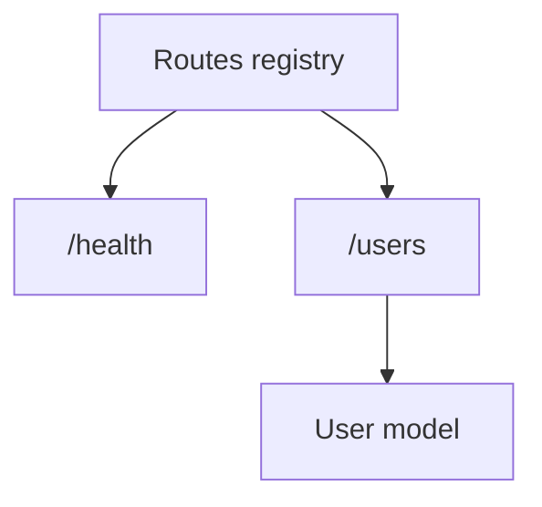
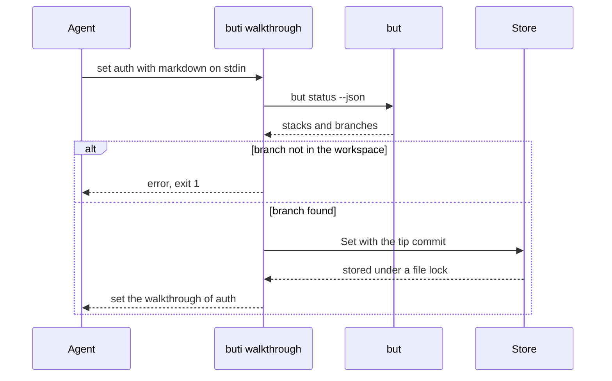

# Example walkthroughs

Walkthroughs as `/buti-walkthrough` writes them and `buti walkthrough show <branch>` prints them. See
[Usage](usage.md#branch-walkthroughs).

## `api` in the test repository

Written by an agent (GPT-5.6 through Kiro) following the skill on the `api` branch of the [test repository](testing.md),
with `buti walkthrough set api --title "Add users API endpoint"`. Only the flowchart labels were quoted afterwards,
which led to the rule on quoting in the skill.

````markdown
## Summary
This branch introduces the API package's route registry and adds a users endpoint alongside the existing health
route. It defines the minimal user data shape returned or handled by that endpoint, establishing the API surface for
users.

## Changes
| Files | Change |
|---|---|
| `src/api/routes.go` | Adds the API route list containing `/health` and `/users` |
| `src/api/users.go` | Adds the `User` type with a name field |

## How it works


## Review effort
1 — Two small API declarations with no request handling logic.

## Risks and test plan
The `/users` route is only registered as a string, so later routing code must connect it to a handler. Reviewers can
confirm that the route list includes both endpoints and that `User` exposes the expected name field.
````

## A change with interactions

For a branch where components talk to each other, the diagram is a sequence diagram. This is the walkthrough of the
branch that added `buti walkthrough set`:

````markdown
## Summary
Adds `buti walkthrough`, the commands a coding agent pins a walkthrough to a branch with. `set` stores the markdown
with the branch's tip commit, so `status` can later say whether the branch moved on, was renamed or left the workspace.

## Changes
| Files | Change |
|---|---|
| `internal/walkthroughcli/*` | The `list`, `show`, `set`, `status` and `clear` subcommands and their `--json` |
| `cmd/buti/main.go` | Dispatches `buti walkthrough` before the TUI starts |
| `docs/usage.md` | Documents the commands and the JSON |

## How it works


## Review effort
2 — A thin CLI over the store, with tests for each command.
````
