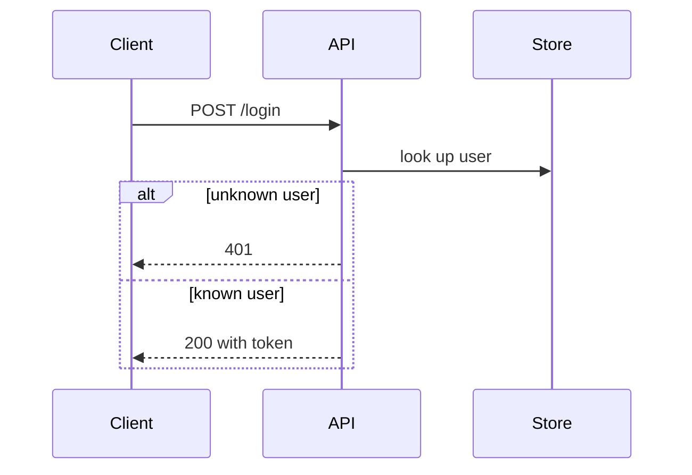
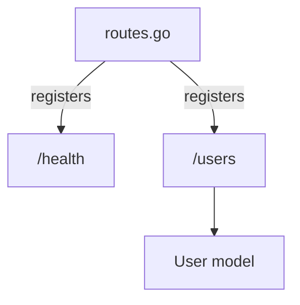

# Write a buti walkthrough

Write a walkthrough of one branch in a GitButler workspace, in the spirit of a CodeRabbit walkthrough: what the branch
changes and why, which files it touches, and a diagram of how the pieces talk to each other. Pin it to the branch with
`buti walkthrough set`, so the user and their reviewers can read it with
[buti](https://github.com/BartInTheField/buti).

This only describes the branch. Don't edit files, and don't change commits or branches. The repository is managed by
GitButler: never run git write commands (`git commit`, `git add`, `git checkout`, `git rebase`, `git stash`,
`git reset` and so on). Reading with git or `but` is fine. The `buti walkthrough` CLI is the only interface to the
walkthroughs: don't read or edit the file they are stored in. Don't write your draft into the repository either;
GitButler would pick it up as a change.

## 1. Check buti

Run `which buti`. If it's missing, stop and tell the user to install it:

```sh
curl -fsSL https://raw.githubusercontent.com/BartInTheField/buti/main/install.sh | sh
```

If `buti walkthrough` reports an unknown command, their buti is too old: tell them to update it (`buti` offers to on
start) and stop. `buti walkthrough set` also needs `but` on `PATH`.

Run the commands from inside the repository, or pass `-C <dir>` before `walkthrough`.

## 2. Pick the branch

Run `but status -f` to see the workspace: each stack, its branches (newest on top) and their commits with their
files. The first token on each line is its shortcode (cli id).

- **A branch name or shortcode was given:** use that branch. If it isn't in `but status`, say so and stop.
- **Nothing was given:** if exactly one branch has commits, use it. Otherwise list the branches with commits and ask
  which one; don't guess.

If the branch has no commits, say there is nothing to walk through yet and stop. A walkthrough describes the branch's
commits, not uncommitted changes.

Run `buti walkthrough status <branch> --json`. When `exists` is true, a walkthrough is already pinned: it will be
replaced, which is what the user wants when it is `stale` (the branch has changed since). `buti walkthrough show
<branch>` prints the old one, if it helps to keep its structure.

## 3. Read the branch

- `but diff <branch>` shows everything the branch changes, relative to the branch below it in its stack (or the base).
- `but diff <commit>` shows one commit; read the commit messages in `but status -f` too, oldest first, for the story.
- Read each changed file around its hunks, not only the diff lines, so you can say how the change fits in: who calls
  the new code, what it calls, which data flows through it.

Only state what the code and commits show. Don't invent related issues, pull requests or reviewers; mention them only
if the commits or the code name them, or a tool you have (such as `gh`) shows them.

## 4. Write the walkthrough

Markdown, in this order. Keep it short: a reviewer should take it in within a couple of minutes.

1. **Summary** (`## Summary`): two to four plain sentences. What the branch does and why, in terms of behaviour, not
   files.
2. **Changes** (`## Changes`): a table of the changed files, grouped where several files do one thing:

   ```markdown
   | Files | Change |
   |---|---|
   | `src/auth/token.go`, `src/auth/token_test.go` | New token auth: issues and checks signed tokens |
   | `src/api/routes.go` | Wires `/login` to the token handler |
   ```

3. **Diagram** (`## How it works`): at least one Mermaid diagram, in a ```` ```mermaid ```` fence.
   - A **`sequenceDiagram`** when the change involves interactions: requests and responses, calls between components,
     events, async work, a CLI talking to a store. Show the main path; use `alt` or `opt` for an important error
     path, not every one.
   - Otherwise a **`flowchart TD`** of the main flow or the data the change touches.
   - Name participants after the real components (`CLI`, `Store`, `API`, a package or type name). Keep labels short
     and plain, with no HTML and no `;`. Five to twelve steps is about right.
   - In a flowchart, write every node as an id and a label, `id[label]`: the id is one plain word (letters, digits,
     `_`), and a node is never a bare string such as `A --> "secret"`. Put the label in double quotes when it has
     anything but letters, digits and spaces: `/`, `(`, `[`, `{`, `<`, `#`, `:` or `.` start a node shape or break
     the parser. Write `H["/health"]`, not `H[/health]`, and `S["returns secret"]`. A label can't contain a double
     quote itself. Edge labels go in pipes: `A -->|calls| B`.
   - If `mmdc` (the Mermaid CLI) is on `PATH`, check each diagram with `mmdc -i <file>.mmd -o <file>.svg`, with the
     files in `$TMPDIR`, and fix what it reports.
4. **Review effort** (`## Review effort`, optional): `1` (trivial) to `5` (hard), with a one-line reason.
5. **Risks and test plan** (`## Risks and test plan`, optional): what could break, what the tests cover, and what a
   reviewer should try by hand. Leave it out rather than pad it.

A short sequence diagram, for reference:

````markdown

````

And a flowchart:

````markdown

````

Pick a title of a few words for the branch, like a pull request title.

## 5. Pin it to the branch

Pass the markdown on stdin, so nothing is written into the repository:

```sh
buti walkthrough set <branch> --title "<title>" <<'EOF'
## Summary
...
EOF
```

(`--body-file <path>` works too, with a file outside the repository, such as in `$TMPDIR`.) The walkthrough is signed
`agent`; `--author <name>` signs it with another name. `set` replaces any earlier walkthrough of the branch, and records
the branch's tip so buti can tell when it goes stale.

Check it with `buti walkthrough show <branch>`.

## 6. Finish

Tell the user the walkthrough is pinned to the branch, with its title and the one-line summary, and that
`buti walkthrough show <branch>` prints it (in a buti that shows walkthroughs in the branch details, they can read it
there too). When the branch changes, running `/buti-walkthrough` again replaces it.
